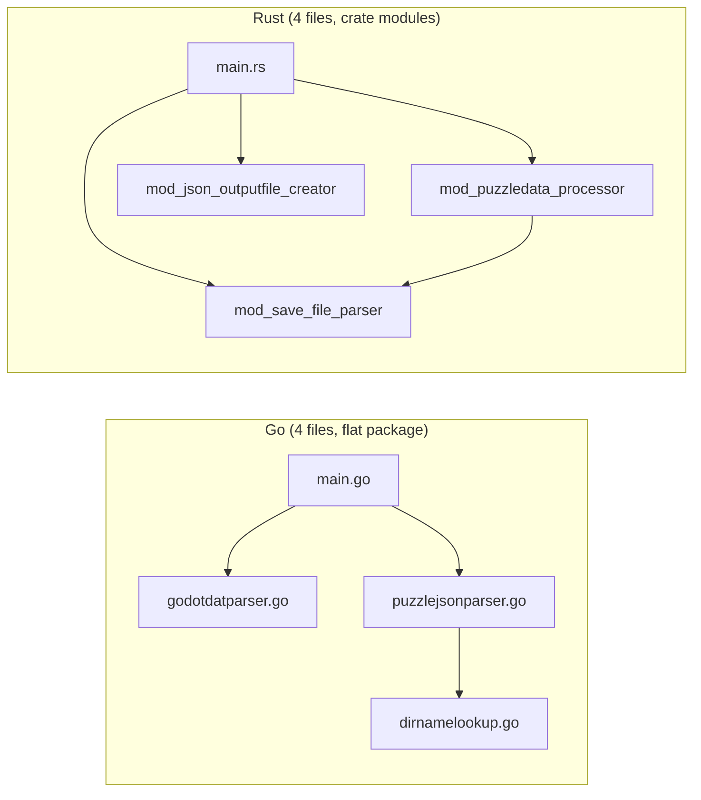

# Replicube Lua Exporter: Go vs Rust Comparison

## Overview

Both implementations parse a Replicube (Godot engine) `progress.dat` savegame file and export Lua solution files organized into chapter/level directories, plus a `puzzles.json` summary.

---

## Lines of Code

| File | Lines |
|------|------:|
| **Go** | |
| [main.go](file:///home/andxyz/code/personal/replicube_lua_exporter/replicube_lua_exporter_golang/main.go) | 82 |
| [godotdatparser.go](file:///home/andxyz/code/personal/replicube_lua_exporter/replicube_lua_exporter_golang/godotdatparser.go) | 309 |
| [puzzlejsonparser.go](file:///home/andxyz/code/personal/replicube_lua_exporter/replicube_lua_exporter_golang/puzzlejsonparser.go) | 107 |
| [dirnamelookup.go](file:///home/andxyz/code/personal/replicube_lua_exporter/replicube_lua_exporter_golang/dirnamelookup.go) | 109 |
| **Go Total** | **607** |
| **Rust** | |
| [main.rs](file:///home/andxyz/code/personal/replicube_lua_exporter/replicube_lua_exporter_rust/src/main.rs) | 55 |
| [mod_save_file_parser.rs](file:///home/andxyz/code/personal/replicube_lua_exporter/replicube_lua_exporter_rust/src/mod_save_file_parser.rs) | 626 |
| [mod_puzzledata_processor.rs](file:///home/andxyz/code/personal/replicube_lua_exporter/replicube_lua_exporter_rust/src/mod_puzzledata_processor.rs) | 209 |
| [mod_json_outputfile_creator.rs](file:///home/andxyz/code/personal/replicube_lua_exporter/replicube_lua_exporter_rust/src/mod_json_outputfile_creator.rs) | 67 |
| **Rust Total** | **957** |

> [!NOTE]
> The Rust version is ~58% larger, mostly due to **16 unit tests** embedded inline (≈230 lines of test code). Without tests, the implementations are close in size.

---

## Feature Comparison

| Feature | Go | Rust |
|---------|:--:|:----:|
| Parse Godot `progress.dat` | ✅ | ✅ |
| Custom recursive-descent parser | ✅ | ✅ |
| Export `.lua` variant files | ✅ | ✅ |
| Generate `puzzles.json` | ✅ | ✅ |
| Main Story puzzles (`source=100`) | ✅ | ✅ |
| Weekly puzzles (`source=400`) | ✅ | ✅ |
| Level name lookup table (100 entries) | ✅ | ✅ |
| Directory name sanitization | ✅ | ✅ |
| String escape handling (`\"`,`\\`,`\n`,`\r`,`\t`) | ✅ | ✅ |
| **`--version` / `-V` flag** | ❌ | ✅ |
| **`--help` auto-generated** | ❌ (manual) | ✅ (clap) |
| **Structured logging (`log` crate)** | ❌ (`log.Fatal`) | ✅ (`log::info!`) |
| **Unit test suite** | ❌ (0 tests) | ✅ (16 tests) |
| **`anyhow` error context** | ❌ | ✅ |
| **`serde` deserialization** | ❌ (stdlib) | ✅ |
| **`phf` compile-time hash map** | ❌ (runtime `map`) | ✅ |
| **`deserialize_null_default` helper** | ❌ | ✅ |
| **Separate JSON file creator module** | ❌ (inline in main) | ✅ |
| **SpecialNumber float formatting** | ✅ (custom type) | ❌ (handled in parser) |
| **Release binary size optimization** | ❌ | ✅ (`opt-level="z"`, LTO, strip) |

---

## Key Differences in Detail

### 1. CLI Argument Parsing

| | Go | Rust |
|--|---|------|
| Library | `flag` (stdlib) | `clap` (derive) |
| `--version` | Not supported | Auto from `Cargo.toml` |
| Help text | Manual `flag.Usage()` | Auto-generated by clap |
| Short flags | `-f`, `-o` | `-f`, `-o` |
| Long flags | `--file`, `--outdir` | `--file`, `--outdir` |

### 2. Testing

- **Go**: **0 unit tests**. Testing is purely integration-based via `mise run test` (export + `diff` against Rust output).
- **Rust**: **16 `#[test]` functions** covering:
  - DataParser (string, bool, number, array, object, string errors)
  - `sanitize_dir_string`
  - `is_main_story_puzzle` / `is_weekly_puzzle`
  - `lookup_main_story_dirname` / `lookup_weekly_dirname`
  - `parse_progress_file` (success + errors)
  - `process_and_create_files`
  - `create_local_json_file`
  - `deserialize_null_default`
  - Uses `tempfile` crate for isolated test directories

### 3. Error Handling

- **Go**: `log.Fatalf()` — prints message and exits immediately. No error wrapping/context.
- **Rust**: `anyhow::Result` with `?` propagation. Errors carry context through the call stack and are reported at `main()`.

### 4. Level Lookup Data Structure

- **Go**: Runtime `map[string]LevelLookup` — allocated and populated at program startup.
- **Rust**: `phf::phf_map!` — compile-time perfect hash map with O(1) lookup and zero runtime initialization cost.

> [!IMPORTANT]
> Both lookup tables contain **exactly 100 identical puzzle-to-directory mappings** across the same 15 chapters. The level name data is fully synced.

### 5. Number Handling

- **Go**: Custom `SpecialNumber` type with `MarshalJSON()` — ensures floats like `12.0` render with a decimal point in JSON (not `12`).
- **Rust**: Handled in the `DataParser` by converting whole floats to `serde_json::Value::Number(u64)` during parsing, letting serde handle the rest consistently.

### 6. Module Structure

- **Go**: Single flat package, all files in one directory. JSON creation is inline in `main.go`.
- **Rust**: Explicit `mod` imports with `pub(crate)` visibility. JSON creation has its own dedicated module.

---

## Mise Tasks Comparison

| Task | Go | Rust |
|------|:--:|:----:|
| `build` | ✅ `go build -trimpath -ldflags='-s -w'` | ✅ `cargo build` |
| `build_release` | ❌ | ✅ `cargo build --release` |
| `test` (umbrella) | ✅ runs `export` + `compare_dirs` | ✅ runs `cargo_test` + `export` + `compare_dirs` |
| `test:cargo_test` | ❌ | ✅ `cargo test` |
| `test:export` | ✅ | ✅ |
| `test:compare_dirs` | ✅ diff vs Rust output | ✅ diff vs Go output |
| `clean_tests_*` | ✅ | ✅ |
| `dump_mysavegame` | ✅ | ❌ |

> [!TIP]
> Both `test:compare_dirs` tasks cross-reference each other — Go diffs against Rust output and vice versa — ensuring **output parity** between the two implementations.

---

## Git History Insights

- **Go**: 19 commits touching the directory. The Go version was the **original implementation**, later ported to Rust (`ade2fc3 Ported to rust`).
- **Rust**: 20+ commits, with active development including:
  - `015fd36` — Comprehensive unit test suite added
  - `f499311` — Level sets/names ported from Go
  - `d14068c` — Switched to structured `log::info!`
  - `144ff14` — Migrated from `OnceCell::Lazy` to `LazyLock`
  - `47a31b8` — `cargo fmt` fixups

The Rust version has seen **more recent active development** (tests, linting, refactoring), while the Go version has been stable since the tooling/mise setup was finalized.

---

## Summary

> [!IMPORTANT]
> **Feature parity on core functionality**: Both produce identical output (validated by `diff --recursive` in both directions). The Rust version adds **developer experience features** — unit tests, `--version`, structured logging, compile-time optimizations, and better error propagation — while the Go version remains a simpler, dependency-light implementation. The Go version has a `dump_mysavegame` convenience task that Rust lacks.
